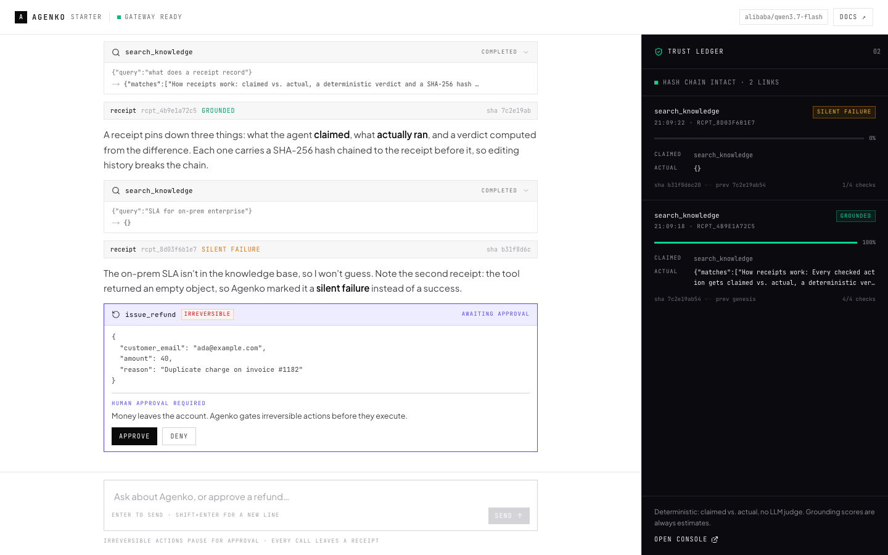

# Agenko Starter

**Live demo → [starter.agenko.app](https://starter.agenko.app)**

A Next.js AI chat app with a **deterministic trust boundary**.

Every tool call leaves an Agenko receipt — what the agent claimed, what actually ran, a verdict, a SHA-256 hash chained to the previous one. Irreversible actions stop until a human approves them, inside the chat.

Built on the Vercel AI chatbot pattern (`useChat`, UI message streams, tool parts) with [`@agenko/sdk`](https://www.npmjs.com/package/@agenko/sdk) as the trust layer.



*Preview rendered with sample receipts. The ledger fills from real tool calls as the agent runs.*

```
you ──▶ /api/chat ──▶ streamText ──▶ tool ──▶ withReceipt() ──▶ agenko.check()
                                          │                        │
                                          │                   receipt + verdict
                                          ▼                        │
                                  toolApproval gate ◀── data-receipt part
                                  (human, in chat)                 │
                                          │                        ▼
                                          └──────────────▶  trust ledger (UI)
```

## Quick start

```bash
pnpm install
cp .env.example .env        # add AI_GATEWAY_API_KEY
pnpm dev
```

Open http://localhost:3000, hit **Launch demo**, sign in with any email and a 4+ character password, then ask for a refund.

Get a key from the [Vercel AI Gateway](https://vercel.com/ai-gateway), or link the project with `vercel link` — the CLI writes a short-lived `VERCEL_OIDC_TOKEN` to `.env.local` and the app uses OIDC instead of a key. The same thing happens automatically on Vercel, so a deployment needs no long-lived secret.

Model slugs are plain strings (`nvidia/nemotron-3.5-lightning-free`, `openai/gpt-6-astra`, `anthropic/claude-sonnet-5.5`, …) so you can swap providers without touching app code.

## What's inside

| Piece | Where |
|---|---|
| Landing page | `app/page.tsx` |
| Dummy sign-in (`/login`) | `app/login/page.tsx`, `components/auth/login-form.tsx` |
| Chat (`/chat`, cookie-gated) | `app/chat/page.tsx`, `proxy.ts` |
| Streaming chat, tool cards, thinking | `components/chat/` |
| Agent loop + approval policy | `lib/ai/agent.ts`, `app/api/chat/route.ts` |
| Tools wrapped in the trust boundary | `lib/ai/tools.ts` |
| `withReceipt()` → `agenko.check()` | `lib/agenko/trust.ts` |
| Live receipt ledger + hash-chain check | `components/chat/trust-ledger.tsx` |
| Tailwind v4 design tokens | `app/globals.css` |

## The two seams that matter

**1. Every tool runs through the receipt wrapper.**

```ts
const { output, receipt } = await withReceipt("send_email", async () => ({
  status: "sent",
  to,
  subject,
}));
```

`withReceipt` calls `agenko.check({ claims: [tool] })`, which returns a receipt with `claimed`, `actual`, `checks`, `grounding_score`, `verdict`, `hash` and `prev_hash`. The route streams it to the browser as a `data-receipt` part; the ledger renders it.

Verdicts are deterministic — no LLM judge:

| Verdict | When |
|---|---|
| `grounded` | output present and the claimed tool matches what ran |
| `silent_failure` | the tool "succeeded" but returned nothing usable |
| `error` | the tool raised |
| `ungrounded` | claim and execution disagree |

**2. Irreversible tools are gated at the call site.**

```ts
toolApproval: {
  issue_refund: {
    type: "user-approval",
    reason: "Money leaves the account.",
  },
},
```

The model can plan the call, but `execute` never runs until `addToolApprovalResponse` comes back from the UI. Deny it and the tool emits `output-denied` — no side effect, and the agent is told to stop.

Try the third suggestion in the empty state ("Refund Ada Chen $40…") to see the gate.

## Tools in this starter

| Tool | Side effect | Gate |
|---|---|---|
| `search_knowledge` | none | receipt |
| `calculator` | none | receipt |
| `send_email` | simulated | receipt |
| `issue_refund` | irreversible | human approval + receipt |
| `delete_account` | irreversible | human approval + receipt |

The knowledge base returns `{}` on a miss, which is exactly the kind of swallowed failure the `silent_failure` verdict exists to catch. Ask "What is the SLA for the on-prem plan?" to watch it fire.

## Add your own tool

```ts
// lib/ai/tools.ts
refund_status: tool({
  description: "Look up a refund by reference.",
  inputSchema: z.object({ reference: z.string() }),
  execute: async ({ reference }) => {
    const { output, receipt } = await withReceipt("refund_status", async () => ({
      reference,
      status: "pending",
    }));
    emit(writer, receipt);
    return output;
  },
}),
```

If it can't be undone, add it to the `toolApproval` map in `app/api/chat/route.ts`.

## Local mode vs. control plane

By default the starter runs **local**: receipts are computed in-process, chained, and streamed to the UI. Nothing leaves the machine.

Set `AGENKO_API_KEY` and optionally `AGENKO_HOST` to also persist receipts and traces, and to link the ledger to your console:

```bash
AGENKO_API_KEY=agk_...
AGENKO_HOST=http://localhost:8000
AGENKO_CONSOLE_URL=http://localhost:3000
```

When your approval inbox lives outside the chat (console, Slack, Discord), swap the in-chat gate for the SDK's blocking gate inside `execute`:

```ts
import agenko from "@agenko/sdk";

const issueRefund = agenko.approve({ when: "irreversible" }, async (input) => {
  return { status: "refunded", ...input };
});
```

See the Python + LangChain starter in [`../agenko-starter-project`](../agenko-starter-project) for that flow end to end.

## Environment

| Variable | Default | Purpose |
|---|---|---|
| `AI_GATEWAY_API_KEY` | — | Gateway key. Optional on Vercel (OIDC is used) |
| `VERCEL_OIDC_TOKEN` | auto | Written by `vercel link` / provided by Vercel |
| `AI_GATEWAY_MODEL` | `nvidia/nemotron-3.5-lightning-free` | Any Gateway model slug |
| `AGENKO_API_KEY` | — | Optional: persist receipts/traces |
| `AGENKO_HOST` | `http://localhost:8000` | Agenko control plane |
| `AGENKO_CONSOLE_URL` | `http://localhost:3000` | Console link target |
| `AGENKO_SERVICE_NAME` | `agenko-starter` | OTEL service name |
| `AGENKO_DEBUG` | `0` | Verbose SDK + tool logging |

## Deploy

```bash
vercel link
vercel --prod
```

Production lives at **[starter.agenko.app](https://starter.agenko.app)**. On Vercel the Gateway auth uses the project's OIDC token, so no `AI_GATEWAY_API_KEY` secret is required — set one only if you want the deployment to use a specific key. Add the optional `AGENKO_*` vars in project settings.

The chat route runs on the Node runtime because the Agenko SDK uses `node:crypto` and OpenTelemetry.

## Auth

`/login` is intentionally a dummy: it validates the email shape, sets an `agenko_demo` cookie and redirects to `/chat`. `proxy.ts` redirects `/chat` to `/login` when the cookie is missing. Replace both with your auth provider — the chat itself never trusts the cookie for anything other than the demo display name.

## UI notes

- Poppins for display, Inter for body, JetBrains Mono for hashes and labels.
- Model reasoning streams into a collapsible **thinking** block; pending responses show an animated thinking row.
- Approval cards, receipts and ledger rows animate in once; reduced-motion is respected.

## Boundaries of this starter

- Receipts live in the message stream and the process-local hash chain — add a database if you need history across restarts.
- The hash chain is verified client-side by comparing `prev_hash` links as receipts arrive.
- Tool side effects are simulated; `send_email`, `issue_refund` and `delete_account` only return data.
- A tool that throws produces a tool error in the UI but no receipt — wrap the body in `try/catch` and return an error object if you need one.
- Grounding scores are estimates. The verdict is the measured part.

## Scripts

```bash
pnpm dev         # dev server
pnpm build       # production build
pnpm start       # serve the build
pnpm lint        # eslint
pnpm typecheck   # tsc --noEmit
```
